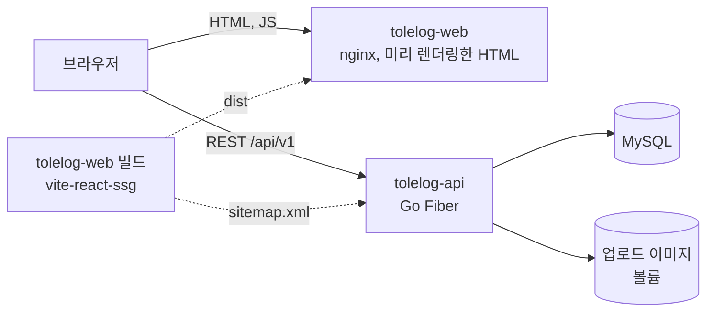

# 아키텍처

## 시스템 구성

| 저장소 | 역할 |
|---|---|
| [tolelog-web](https://github.com/tolelom/tolelog-web) | 웹 프론트엔드, 공개 페이지 미리 렌더링 |
| tolelog-api(이 저장소) | REST API, 인증, 이미지 업로드, RSS, 사이트맵 |

tolelog-web은 빌드할 때 이 서버의 `/sitemap.xml`을 읽어 미리 렌더링할 공개 경로를 정합니다.

## 코드 지도

요청은 handler → service 인터페이스 → GORM 순서로 흐릅니다. `internal/router`가 service를 만들어 handler에 넣습니다.

| 경로 | 책임 |
|---|---|
| `cmd/server` | 진입점, 설정 로드, DB 연결, graceful shutdown |
| `internal/router` | 라우트, 미들웨어 구성, 경로별 rate limit |
| `internal/post`, `comment`, `series`, `tag`, `user` | 영역별 handler와 service |
| `internal/image`, `internal/upload` | 이미지 업로드 처리, 파일 앞부분으로 MIME 판별, 크기 제한 |
| `internal/feed`, `internal/sitemap` | RSS 피드, 사이트맵 |
| `internal/model` | GORM 모델, 공개 범위 조건 |
| `internal/dto` | 요청과 응답 타입 |
| `internal/validate` | 공용 validator와 사용자 정의 규칙 |
| `internal/middleware` | 인증, 오류 처리, 패닉 복구, 보안 헤더, 요청 로그 |
| `internal/config` | 환경 변수, DB 연결, 자동 마이그레이션 |
| `internal/auth` | JWT access·refresh 토큰, bcrypt 비밀번호 해시 |
| `internal/markdown`, `internal/permalink` | 마크다운 발췌, 사이트 주소·슬러그·글 경로 |
| `internal/observability` | Sentry 오류 보고(`SENTRY_DSN`이 없으면 slog 로그만) |
| `internal/testutil` | 테스트용 인메모리 SQLite와 픽스처 |
| `docs` | Swagger 문서(swag 생성, 직접 고치지 않음) |

`/health`, `/health/ready`, `/feed`, `/sitemap.xml`은 `/api/v1` 밖에 있어 Swagger에 싣지 않습니다.

## 지켜야 할 규칙

- 글 공개 범위는 `internal/model/post.go`의 `VisibleTo`(상세)와 `PublicPosts`(목록)가 정하고, 두 함수는 같은 기준(공개 발행 글은 누구나, 나머지는 작성자만)을 유지합니다.
- GORM `DB.Save`를 쓰지 않습니다. 바꿀 칸만 `Updates`·`Update`·`UpdateColumn`으로, 새 행은 `Create`로 씁니다. `golangci-lint`의 forbidigo 규칙이 막습니다.
- 글 경로와 슬러그는 `internal/permalink`가 만들고, tolelog-web의 `src/features/posts/slug.ts`와 같은 결과를 내야 합니다.
