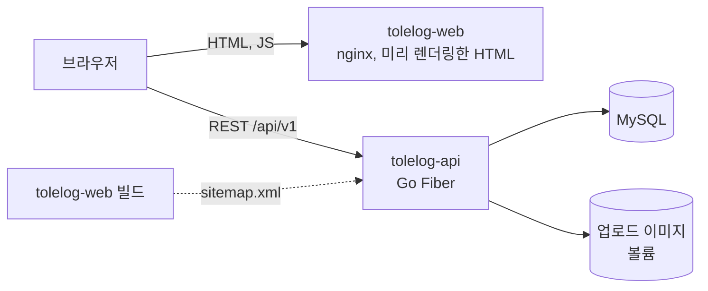
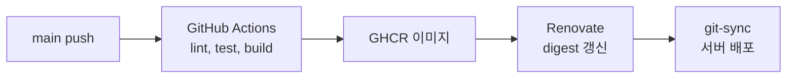

# Tolelog API

> 개인 블로그 플랫폼의 REST API 서버

Go · Fiber v2 · GORM · MySQL · 서비스 https://blog.tolelom.xyz

## 개요

Tolelog는 마크다운으로 글을 쓰고 시리즈로 묶어 발행하는 블로그 플랫폼이다. 이 저장소는 그 API 서버로, 글, 댓글, 좋아요, 태그, 시리즈, 사용자, 이미지 업로드를 다루고 RSS 피드와 사이트맵을 낸다.

글은 공개 여부와 상태(발행, 임시저장)를 가진다. 공개된 발행 글은 누구나 보고, 비공개 글과 임시저장 글은 작성자만 본다. 목록과 상세 조회가 같은 기준을 쓴다.

웹 프론트엔드는 빌드할 때 이 서버의 `sitemap.xml`을 읽어 미리 렌더링할 공개 경로를 정한다.

## 시스템 구성





| 저장소 | 역할 |
|---|---|
| [tolelog-web](https://github.com/tolelom/tolelog-web) | 웹 프론트엔드, SSG 미리 렌더링 |
| tolelog-api | REST API, 인증, 이미지 업로드, RSS, 사이트맵(이 저장소) |

## 기능

- 글 작성, 수정, 삭제, 검색, 페이지네이션, 태그 필터
- 공개 여부와 상태(발행, 임시저장)에 따른 조회 범위, 임시저장 목록
- 댓글과 대댓글
- 좋아요
- 시리즈: 글 묶기, 순서 변경, 이전/다음 이동
- 이미지와 아바타 업로드: 파일 앞부분으로 MIME 판별, 크기 제한
- 인증: JWT access와 refresh 토큰, bcrypt 비밀번호. 비밀번호 변경 시 토큰 버전을 올려 기존 세션 무효화
- RSS 피드(`/feed`), XML 사이트맵(`/sitemap.xml`)
- 운영: 경로별 rate limit, 보안 헤더, CORS, gzip 압축, slog 구조화 로그, Sentry 오류 보고(DSN 설정 시), graceful shutdown
- 헬스 체크(`/health`, `/health/ready`), 개발 환경 Swagger(`/swagger/`)

## 구조

| 경로 | 책임 |
|---|---|
| `cmd/server` | 진입점, 설정 로드, DB 연결, graceful shutdown |
| `internal/router` | 라우트, 미들웨어 구성, 경로별 rate limit |
| `internal/post`, `comment`, `series`, `tag`, `user` | 영역별 handler와 service |
| `internal/image`, `internal/upload` | 이미지 업로드 처리와 MIME 검증 |
| `internal/feed`, `internal/sitemap` | RSS 피드, 사이트맵 |
| `internal/model` | GORM 모델, 공개 범위 쿼리 |
| `internal/dto` | 요청과 응답 타입 |
| `internal/middleware` | 인증, 오류 처리, 패닉 복구, 보안 헤더, 요청 로그 |
| `internal/config` | 환경 변수, DB 연결, 자동 마이그레이션 |
| `internal/utils` | JWT, 비밀번호, 슬러그, Sentry |
| `internal/testutil` | 테스트용 인메모리 SQLite와 픽스처 |
| `docs` | Swagger 문서(swag 생성) |

## 실행

Go와 MySQL이 필요하다.

```bash
git clone https://github.com/tolelom/tolelog-api.git
cd tolelog-api

cp .env_example .env
# DB 접속 정보, JWT_SECRET 설정. PORT를 비우면 8080
go run ./cmd/server
```

시작할 때 GORM이 테이블을 자동 마이그레이션한다. 로컬 tolelog-web은 API를 `localhost:3000`으로 보므로 함께 띄울 때는 `PORT=3000`으로 둔다.

| 명령 | 용도 |
|---|---|
| `go run ./cmd/server` | 서버 실행 |
| `go test ./...` | 테스트(DB 테스트는 인메모리 SQLite) |
| `golangci-lint run` | 린트(`.golangci.yml`) |
| `swag init -g cmd/server/main.go` | Swagger 문서 생성 |
